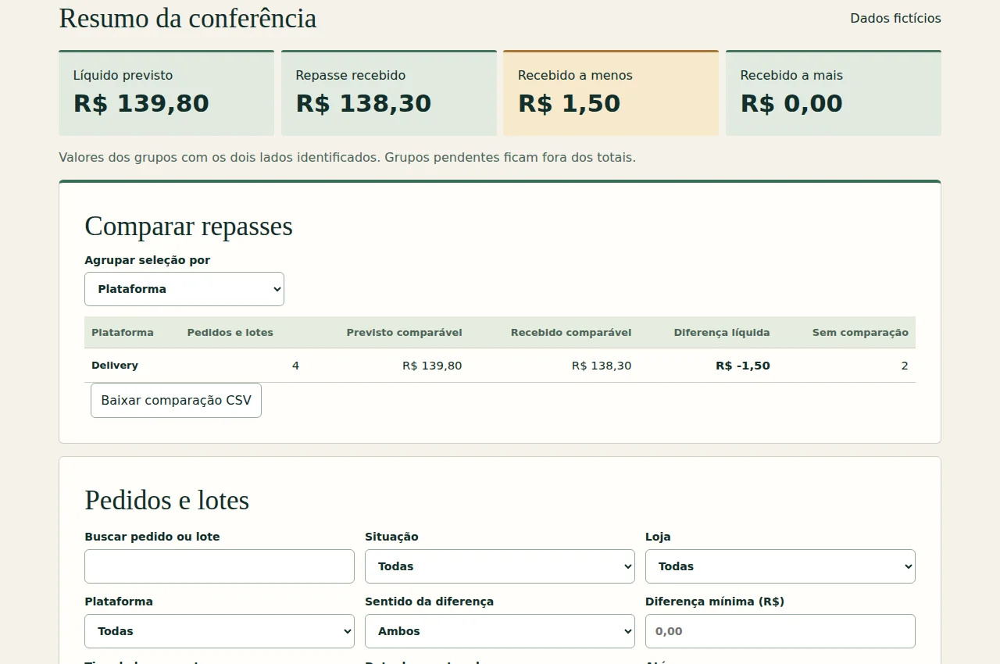

# Fecha a Conta

**Experimente em um minuto.** Abra o exemplo fictício, busque o pedido **0019** e abra a memória de cálculo. A diferença de **R$ 1,50** está ligada às linhas do pedido e do repasse.

[Abrir demonstração](https://ykauttiz.github.io/fecha-a-conta/) · [Portfólio do Kauê](https://ykauttiz.github.io/contratempo/portfolio/)

**Conferência local de pedidos, taxas e repasses de delivery em reais.** Abra a demonstração ou importe CSVs de uma loja. Cada resultado leva aos arquivos e linhas usados no cálculo.

As exportações destinadas a planilhas tratam prefixos de fórmula ASCII, caracteres de controle e variantes Unicode conhecidas. A proteção é aplicada célula por célula antes de gerar o CSV.

[Abrir a conferência](https://ykauttiz.github.io/fecha-a-conta/) · [Histórico](CHANGELOG.md) · [Testes](https://github.com/ykauttiz/fecha-a-conta/actions/workflows/conferencia.yml)

## Aparência e navegação

No cabeçalho, escolha **Sistema**, **Claro** ou **Escuro**. Sistema acompanha o aparelho. O navegador guarda a escolha localmente para a próxima visita. Use Tab para chegar ao atalho de conteúdo e aos controles. As transições respeitam a preferência de movimento reduzido.

## Primeiro fechamento

1. Abra **Exemplo fictício**. O pedido 0017 vendeu R$ 85,00, com R$ 10,20 de comissão e R$ 5,00 de cupom da loja. Restaram R$ 69,80. Outro pedido acrescentou R$ 30,00 ao lote L01. Dois depósitos de R$ 60,00 e R$ 39,80 fecharam o lote.
2. Para usar seus extratos, escolha o CSV de pedidos e/ou o de repasses. Se reunir várias lojas ou plataformas, identifique-as nos arquivos ou nos campos da importação.
3. Prepare a prévia, associe cada campo a sua coluna e confira a primeira linha. A importação valida todas as linhas antes de atualizar o fechamento. A primeira importação própria substitui o exemplo.
4. Clique no pedido ou lote para abrir a memória de cálculo. Registre o motivo de uma revisão, baixe as evidências CSV ou imprima a seleção inteira para PDF.
5. Baixe um backup JSON antes de fechar a aba. O backup inclui os dados originais e as notas de revisão em texto legível. Para retomá-lo, abra **Restaurar um fechamento**. O site processa os arquivos no navegador, sem cadastro.

[Pedidos do exemplo](exemplos/pedidos-lote.csv) · [Repasses do exemplo](exemplos/repasses-lote.csv)

## Colunas e valores

| Campo | O que informar |
|---|---|
| pedido, lote | Pelo menos um por linha. Identificadores textuais preservam zeros. Com lote, a comparação usa o lote dos dois lados. Sem lote, usa o pedido. |
| valor | BRL com até 18 dígitos inteiros e dois decimais. Use 1234,56 ou 1234.56. Em CSV separado por vírgula, envolva valores com vírgula em aspas. |
| evento | Identificador estável daquele lançamento no lado, loja e plataforma. Necessário para somar várias linhas do mesmo grupo com confiança. Parcelas e ajustes têm IDs próprios. |
| tipo | No previsto, use venda, comissao, tarifa, desconto_loja, subsidio, ajuste, estorno ou liquido. No recebido, use repasse. Sem tipo, o previsto é tratado como líquido informado. |
| data | Data do evento em AAAA-MM-DD. A competência e o pagamento podem cair em meses diferentes. |
| loja, plataforma | Mantêm registros de origens diferentes separados. Os valores das colunas prevalecem sobre os dados gerais do arquivo. |

Os modelos simples [pedidos.csv](pedidos.csv) e [repasses.csv](repasses.csv) continuam aceitos. No formato simples, o valor previsto já é líquido. Aceitamos UTF-8 com ou sem BOM, ponto e vírgula ou vírgula, aspas duplas escapadas e quebras de linha em campos entre aspas. O limite é 4 MiB e 50 mil linhas por arquivo, até 50 arquivos e 16 milhões de caracteres por sessão.

## Como os valores são conferidos

- Venda e subsídio somam. Comissão, tarifa, cupom custeado pela loja e estorno subtraem o módulo do valor. Ajustes, valores líquidos e depósitos preservam o sinal informado. Uma reversão de débito pode ser informada como ajuste positivo.
- A comissão opcional incide sobre cada venda bruta do arquivo. Informe o percentual do contrato aplicável ao período, com até duas casas decimais. O cálculo arredonda meio centavo para cima por venda. Separe os arquivos se a regra mudar. Uma comissão explícita no mesmo grupo que uma comissão calculada leva o grupo para revisão.
- Valores e somas usam inteiros exatos em centavos. A diferença é recebido menos previsto. Recebido a menos e a mais aparecem em indicadores separados.
- Loja, plataforma, tipo de chave e identificador precisam corresponder. Um depósito sem a chave de lote correspondente permanece pendente. O sistema não distribui um depósito entre pedidos por estimativa.
- O mesmo arquivo, lado, loja e plataforma é ignorado por SHA-256 do texto decodificado. Retire o arquivo antes de trocar seu mapeamento. Reexportações com ID e conteúdo financeiro idênticos contam uma vez. IDs em conflito, duplicatas ambíguas e mistura de líquido com componentes ficam pendentes. Sem ID de evento, use uma linha por lado por grupo.
- O filtro de data seleciona o grupo se **qualquer evento** estiver no período e mantém o grupo completo. Valores sem par e grupos ambíguos ficam fora dos totais comparáveis. Uma revisão humana anota a investigação e preserva a diferença calculada.

## iFood e 99Food

O iFood descreve um relatório mensal atualizado por eventos. A 99Food documenta pagamentos divididos. Ambos os casos motivam o uso de lotes, datas de eventos e importação incremental. A importação disponível é por mapeamento de CSV. A escolha da plataforma identifica a origem. Para homologar um layout específico, ainda são necessárias amostras autorizadas e anonimizadas com totais conhecidos. Não há conexão com contas ou API das plataformas.

[Relatório de conciliação do iFood](https://blog-parceiros.ifood.com.br/relatorio-de-conciliacao/) · [Pagamento dividido da 99Food](https://99app.com/99food/restaurantes/guias/como-acompanhar-seus-repasses-e-entender-o-novo-pagamento-dividido/)

## Desenvolvimento

Abra index.html para uso offline ou rode `python -m http.server 8000` para servir a pasta. Na versão HTTP local ou HTTPS, a conferência roda em um Web Worker. Com o arquivo HTML aberto diretamente, o cálculo roda na página.

- `book.js` lê CSV, valida lançamentos, agrupa por origem e calcula as diferenças. `worker.js` executa esse motor fora da interface.
- `app.js` gerencia importações, seleção, histórico e exportação. `core.js` mantém a API JavaScript anterior para consumidores do comparador simples.
- `node --test` executa os testes do motor, incluindo 10 mil pedidos. A integração contínua testa o navegador em 375 e 1280 px, além do fluxo de backup e restauração.

Filtre por tipo de lançamento, sentido da diferença e valor mínimo em reais. O filtro por tipo seleciona o grupo completo: ao procurar comissão, você continua vendo os depósitos e o previsto daquele lote. Os limites em centavos são inclusivos e valem também para os totais, a impressão e o CSV.

Ordene pedidos e lotes por maior diferença absoluta ou maior repasse recebido. A ordem também vale para o CSV e a impressão. Use **Limpar filtros e ordenação** para voltar à seleção completa.

Em **Comparar repasses**, alterne entre plataforma e loja. O quadro acompanha os filtros e soma apenas os grupos comparáveis. Pedidos e lotes sem comparação aparecem na última coluna. Um travessão indica que nenhum valor pôde ser comparado.
O resumo por loja ou plataforma exibe até 25 linhas por página. **Baixar comparação CSV** inclui todas as linhas do resumo filtrado.

Na prévia de um CSV, guarde o mapeamento das colunas e reaplique-o quando plataforma, cabeçalho e tipo de arquivo coincidirem. O modelo guarda a correspondência dos campos.

[Ver testes e capturas de celular e computador](https://github.com/ykauttiz/fecha-a-conta/actions/workflows/conferencia.yml). Na execução, abra o artefato **capturas-chromium** ou **capturas-firefox**. As imagens usam dados fictícios.

A impressão do fechamento inclui totais comparáveis, diferenças a mais e a menos e quantidade de grupos pendentes, junto das linhas de evidência da seleção.

## Privacidade, segurança e contribuição

Os extratos são lidos e calculados no navegador e não são enviados a nenhum servidor. O backup JSON inclui os dados originais importados e as notas de revisão: guarde-o como um arquivo financeiro. Nunca publique extratos reais em issues ou pull requests.

Para relatar uma falha, veja [SECURITY.md](SECURITY.md). Para propor mudanças, veja [CONTRIBUTING.md](CONTRIBUTING.md). Use somente dados fictícios ou anonimizados em issues e pull requests.

## Publicar uma versão

Atualize `RELEASE.md` com as mudanças verificadas. Para marcar uma entrega, use na branch principal um commit com o título `release(vAAAA.MM.DD) Título da atualização`. Para uma segunda edição no mesmo dia, acrescente um número à versão, como `vAAAA.MM.DD.1`. O GitHub Actions publica a release após a aprovação dos testes. Commits comuns continuam atualizando o site.
